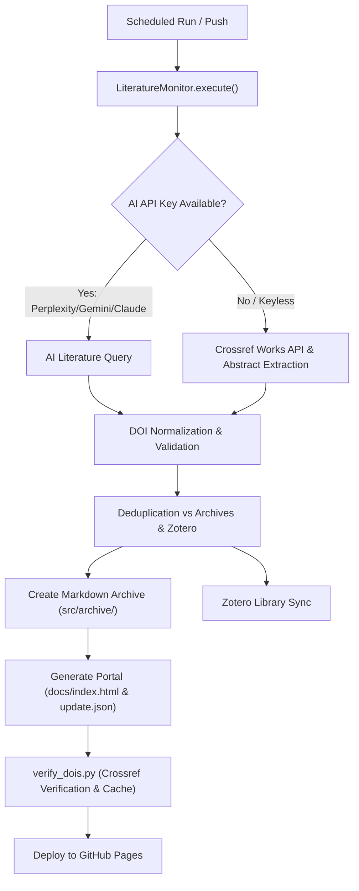

# Biorobotics Literature Monitor & Paper Compiler

Automated academic literature tracking, verification, and web portal compilation for biorobotics, neural decoding, and neuroprosthetics research.

[](https://github.com/firmanserdana/research-assistant-paper-compiler/actions/workflows/literature.yml)

Live web portal: [firmanserdana.github.io/research-assistant-paper-compiler](https://firmanserdana.github.io/research-assistant-paper-compiler/)

---

## Key Features

- **Multi-Provider AI & Keyless Scholarly Discovery**:
  - **Perplexity** (`sonar-pro`, `sonar-reasoning`) for deep academic research and summaries.
  - **Google Gemini** (`gemini-2.5-flash`, `gemini-1.5-pro`) via OpenAI-compatible SDK.
  - **Anthropic Claude** (`claude-3-5-sonnet`) with native message API support.
  - **OpenAI** (`gpt-4o-mini`) and **Ollama** (local offline models).
  - **OpenAlex API Integration (`--provider openalex`)**: 100% keyless discovery and bibliometric enrichment (official Journal/Venue name, true Publication Year, Citation Counts, inverted-index abstract recovery, and Open Access PDF resolution).
  - **Semantic Scholar Graph API (`--provider semanticscholar`)**: Keyless discovery with automated AI **TL;DR** extraction, open-access PDF links, and citation metrics.
  - **arXiv API Integration (`--provider arxiv`)**: 100% keyless discovery of neural engineering & biorobotics preprints with direct PDF resolution and OpenAlex fallback.
  - **Crossref Public API (`--provider crossref`)**: Keyless bibliographic search with biorobotics relevance filtering and JATS XML abstract extraction.
- **Accurate DOI Verification, Canonicalization & Evidence-Based TRL**:
  - Remote verification against Crossref, DataCite, and bioRxiv APIs with title similarity validation ($\ge 0.70$) and local caching (`doi_verification_cache.json`).
  - Evidence-grounded **TRL Estimator (`TRL 1–8`)** evaluating clinical, preclinical, and engineering maturity indicators.
- **Modern Interactive Research Portal (`docs/index.html`)**:
  - **Elicit-Style Structured Evidence Matrix View**: Switch between **Card Grid View** and a side-by-side **Evidence Matrix Table** comparing `Paper & TL;DR`, `Subject / Population`, `Interface & Method`, `Venue & Year`, `TRL`, and `Citation Velocity`.
  - **Automated 1-Sentence TL;DR & Citation Velocity**: Highlights the key empirical finding (`TL;DR`) and computes **Citations / Year (`cit/yr`)** to surface fast-rising recent papers alongside total citation counts.
  - **`arxiv-sanity-lite` Personalized Recommender**: Star (`★`) papers to build a local Reading List and sort by **"Recommended (Based on Saved ★)"** with live **`Match %`** badges based on keyword, modality, and title similarity.
  - **Interactive Analytics & Timeline Drawer**: Visualizes the TRL Readiness Pipeline, Study Modality breakdown, Top Publishing Journals/Venues, and **Publication Year Timeline** (click any segment, year, or chip to filter).
  - **1-Click External Citation Graph Exploration**: Jump directly from any paper card to its **Connected Papers** graph, **Semantic Scholar** profile, or **Google Scholar** citations.
  - **Related Papers in Archive**: Precomputes the top 3 most similar papers per card with 1-click smooth navigation and card highlighting.
  - **Batch Citation Export**: 1-click export of filtered papers as **BibTeX (`.bib`)**, **RIS (`.ris`)**, or **CSV (`.csv`)** with full venue, year, TL;DR, and citation velocity metadata.
  - **Shareable Deep Links**: Real-time URL query parameter synchronization (`?q=...&cat=...&trl=...&mod=...&yr=...&view=table`).
  - **Open Access Direct PDF Filter & RSS 2.0 Feed (`docs/feed.xml`)**.
- **Zotero Integration & CI/CD Reporting**: Automatic Zotero sync, GitHub Actions Job Summary (`$GITHUB_STEP_SUMMARY`), and optional Slack/Discord webhook alerts.

---

## Quick Start (Local Setup)

### 1. Clone & Set Up Virtual Environment

```bash
git clone https://github.com/firmanserdana/research-assistant-paper-compiler.git
cd research-assistant-paper-compiler

python3 -m venv .venv
source .venv/bin/activate
pip install -r requirements.txt
```

### 2. Configure Environment (Optional)

Create a `.env` file in the root directory:

```env
# Optional: AI Provider keys (Crossref and arXiv work without any keys)
PPLX_API_KEY=pplx-...
GEMINI_API_KEY=...
ANTHROPIC_API_KEY=sk-ant-...
OPENAI_API_KEY=sk-...

# Optional: Zotero sync
ZOTERO_USER_ID=...
ZOTERO_API_KEY=...
```

### 3. Run the Literature Monitor & CLI Options

```bash
# Standard run (discovers new papers, updates archives, generates portal & RSS feed)
python src/monitor.py

# Safe dry-run test (searches & validates without writing archives or modifying Zotero)
python src/monitor.py --dry-run --limit 3

# Query arXiv directly for preprints on a custom topic
python src/monitor.py --provider arxiv --term "soft robotic hand" --limit 5 --dry-run

# Include arXiv preprints alongside default AI / Crossref search
python src/monitor.py --include-arxiv

# Regenerate portal website and RSS feed from existing archives at any time
python src/monitor.py --generate-site-only
# or:
python regenerate_site.py

# Verify archive DOIs against Crossref (uses cache)
python verify_dois.py

# Repair invalid/missing DOIs
python repair_archives.py
```

### 4. Run Test Suite

```bash
pytest -v
```

---

## Architecture & Workflow



---

## Customization

- **Search Queries**: Add or modify search terms in `search_terms.txt` (one per line).
- **Quality & TRL Thresholds**: Adjust validation criteria in `LiteratureMonitor._validate()`.
- **Portal Template**: Customize layout, styles, or cards in `src/templates/index.html`.
