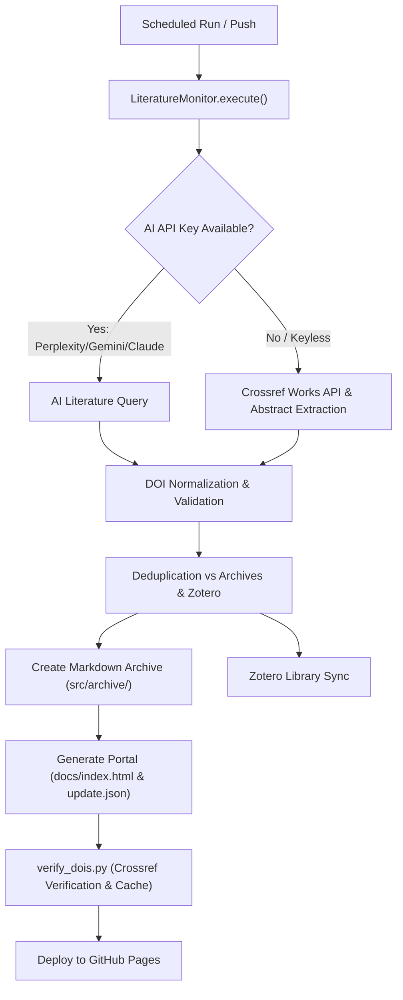

# Biorobotics Literature Monitor & Paper Compiler

Automated academic literature tracking, verification, and web portal compilation for biorobotics, neural decoding, and neuroprosthetics research.

[](https://github.com/firmanserdana/research-assistant-paper-compiler/actions/workflows/literature.yml)

Live web portal: [firmanserdana.github.io/research-assistant-paper-compiler](https://firmanserdana.github.io/research-assistant-paper-compiler/)

---

## Key Features

- **Multi-Provider AI & Keyless Scholarly Discovery**:
  - **Perplexity** (`sonar-pro`, `sonar-reasoning`) for deep academic research and summaries.
  - **Google Gemini** (`gemini-2.5-flash`, `gemini-1.5-pro`) via OpenAI-compatible SDK.
  - **Anthropic Claude** (`claude-3-5-sonnet`) with native message API support.
  - **OpenAI** (`gpt-4o-mini`) and **Ollama** (local offline models).
  - **arXiv API Integration**: 100% keyless, free discovery of latest neural engineering & biorobotics preprints with direct PDF resolution.
  - **Crossref Public API**: 100% keyless fallback with JATS XML abstract and Open Access link extraction.
- **Accurate DOI Verification & Safe Normalization**:
  - Non-destructive DOI normalization preserving suffix numbers (`10.xxxx/yyyy`).
  - Remote verification against the Crossref API with local caching (`doi_verification_cache.json`) for near-instant repeated runs.
  - Automatic DOI repair via Crossref bibliographic title lookup.
- **Modern Interactive Research Portal (`docs/index.html`)**:
  - Dark / Light mode toggle with persistent local storage.
  - Instant client-side search across title, authors, keywords, summary, and DOI.
  - Dynamic category pills and Technology Readiness Level (TRL 1-9) filters with real-time paper counts.
  - **Personal Reading List / Favorites**: Star (`★`) papers to save in browser local storage and filter at any time.
  - **Batch Citation Export**: 1-click export of currently filtered papers as **BibTeX (`.bib`)**, **RIS (`.ris`)** (for EndNote/Mendeley/Zotero), or **CSV (`.csv`)**.
  - **Shareable Deep Links**: Real-time URL query parameter synchronization (`?q=...&cat=...&trl=...`).
  - **Open Access Direct PDF Buttons**: 1-click access to open-access PDFs and arXiv preprints.
  - **RSS 2.0 / Atom Feed (`docs/feed.xml`)**: Live feed for RSS readers (NetNewsWire, Feedly, Slack RSS).
- **Zotero Integration**: Automatic library sync, collection management, and duplicate prevention.
- **Automated CI/CD**: Weekly GitHub Actions schedule compiles new papers, verifies DOIs, and publishes to GitHub Pages.

---

## Quick Start (Local Setup)

### 1. Clone & Set Up Virtual Environment

```bash
git clone https://github.com/firmanserdana/research-assistant-paper-compiler.git
cd research-assistant-paper-compiler

python3 -m venv .venv
source .venv/bin/activate
pip install -r requirements.txt
```

### 2. Configure Environment (Optional)

Create a `.env` file in the root directory:

```env
# Optional: AI Provider keys (Crossref and arXiv work without any keys)
PPLX_API_KEY=pplx-...
GEMINI_API_KEY=...
ANTHROPIC_API_KEY=sk-ant-...
OPENAI_API_KEY=sk-...

# Optional: Zotero sync
ZOTERO_USER_ID=...
ZOTERO_API_KEY=...
```

### 3. Run the Literature Monitor & CLI Options

```bash
# Standard run (discovers new papers, updates archives, generates portal & RSS feed)
python src/monitor.py

# Safe dry-run test (searches & validates without writing archives or modifying Zotero)
python src/monitor.py --dry-run --limit 3

# Query arXiv directly for preprints on a custom topic
python src/monitor.py --provider arxiv --term "soft robotic hand" --limit 5 --dry-run

# Include arXiv preprints alongside default AI / Crossref search
python src/monitor.py --include-arxiv

# Regenerate portal website and RSS feed from existing archives at any time
python src/monitor.py --generate-site-only
# or:
python regenerate_site.py

# Verify archive DOIs against Crossref (uses cache)
python verify_dois.py

# Repair invalid/missing DOIs
python repair_archives.py
```

### 4. Run Test Suite

```bash
pytest -v
```

---

## Architecture & Workflow



---

## Customization

- **Search Queries**: Add or modify search terms in `search_terms.txt` (one per line).
- **Quality & TRL Thresholds**: Adjust validation criteria in `LiteratureMonitor._validate()`.
- **Portal Template**: Customize layout, styles, or cards in `src/templates/index.html`.
